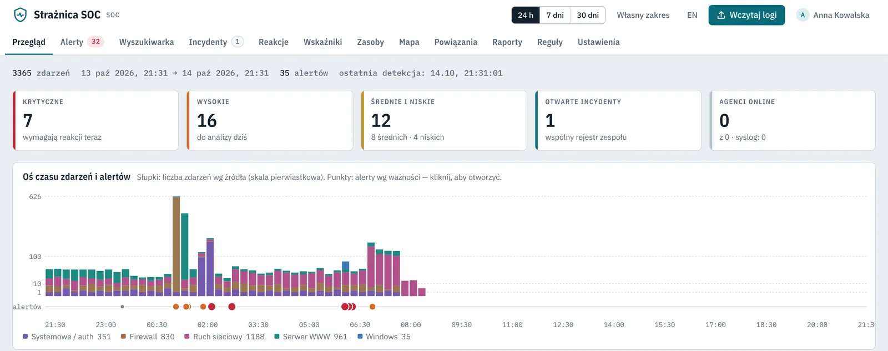
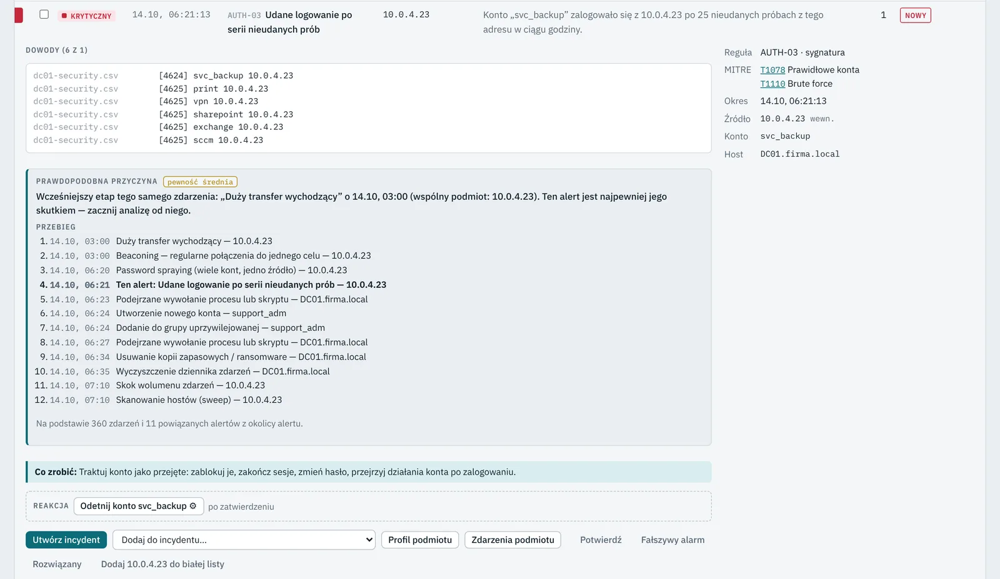
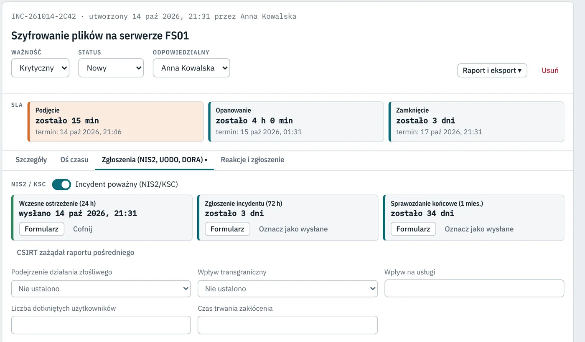

# 🛡️ Strażnica SOC

**Polski SIEM i system obsługi incydentów,który wykrywa ataki, wskazuje ich przyczynę i prowadzi zespół do zgłoszenia w CSIRT w terminach NIS2/KSC.**

Działa lokalnie na Windows Server · bez chmury · bez opłat za gigabajt logów · konsola po polsku i angielsku

[**⬇ Pobierz wersję 2.5.0**](https://github.com/podatnosci/straznica-soc/releases/latest) · [Instalacja](docs/INSTALACJA.md) · [Licencja](LICENSE.md) · [Zgłoś błąd](https://github.com/podatnosci/straznica-soc/issues) · [Kontakt](#kontakt-pilotaż-i-licencje)

## Dla kogo

- **Podmioty kluczowe i ważne według ustawy o KSC (NIS2)**, które muszą wykryć incydent i wysłać wczesne ostrzeżenie do CSIRT w ciągu 24 h.
- **Średnie firmy bez własnego SOC**: jeden informatyk albo mały zespół, który potrzebuje gotowych reguł zamiast budowy platformy od zera.
- **Firmy IT i MSSP** świadczące usługi monitoringu: tryb wielu klientów z osobną bazą dla każdego.
- **Audytorzy i zespoły reagowania**: konsola offline analizuje pliki logów bez instalowania serwera.

## Co potrafi

| Obszar | Co robi |
|---|---|
| 🔎 **Wykrywanie** | ponad 100 wbudowanych reguł zmapowanych na MITRE ATT&CK, import reguł Sigma, odchylenia od normy dla kont i hostów, wskaźniki zagrożeń z MISP, TAXII 2.1, abuse.ch i listy ostrzeżeń CERT Polska |
| 🧠 **Przyczyna źródłowa (RCA)** | przy każdym alercie łańcuch powiązanych zdarzeń, najwcześniejszy etap, cykliczność i zalecenie, co zrobić |
| 📥 **Źródła logów** | agenci Windows i Linux, syslog UDP/TCP, Microsoft 365, Entra ID, Defender for Endpoint, Google Workspace, AWS CloudTrail, Azure; ok. 50 formatów plików rozpoznawanych automatycznie (m.in. EVTX, CEF/LEEF, SentinelOne, Graylog, FortiGate, Palo Alto, MikroTik, Wazuh, Nessus, Outlook .msg, archiwa ZIP/GZ) |
| 📋 **Zgłoszenia** | formularze NIS2/KSC na każdy etap: wczesne ostrzeżenie 24 h, zgłoszenie 72 h, raport pośredni, sprawozdanie z postępu, sprawozdanie końcowe; zgłoszenie naruszenia do UODO (art. 33 RODO), klasyfikacja i raporty DORA; przypomnienia o terminach |
| ⚡ **Reakcja** | zawsze po zatwierdzeniu przez człowieka: blokada adresu na FortiGate, pfSense i MikroTik, odcięcie konta w AD i Entra ID, izolacja komputera w Microsoft Defender |
| 👥 **Praca zespołu** | incydenty z SLA i playbookami, oś czasu incydentu, wyszukiwarka z językiem zapytań, dyżury i eskalacja (SMS, połączenie, powiadomienie), Jira / ServiceNow / GLPI, raporty PDF z logo firmy |
| 🔐 **Rozliczalność** | role (odczyt, analityk, kierownik, administrator), dziennik audytu chroniony łańcuchem skrótów HMAC, wykrywa zmianę lub usunięcie wpisu |
| 🏢 **Skala** | tryb wielu klientów (usługi SOC), serwer zapasowy przejmujący pracę przy awarii, archiwum zdarzeń z sumami SHA-256 |

### Przyczyna alertu wskazana automatycznie

### Terminy NIS2/KSC pod kontrolą

*Zrzuty ekranu pokazują dane przykładowe wbudowane w aplikację.*

## Pobieranie

Pliki są w zakładce [**Releases**](https://github.com/podatnosci/straznica-soc/releases/latest):

| Plik | Do czego |
|---|---|
| `StraznicaSOC-Serwer-Setup-2.5.0.exe` | serwer centralny z konsolą WWW (Windows Server 2016–2025, Windows 10/11, 64-bit) |
| `StraznicaAgent-Setup.exe` | agent Windows zbierający dzienniki zdarzeń (do pobrania także z konsoli serwera) |
| `StraznicaSOC-Konsola-Setup-2.5.0.exe` | konsola analityka; bez serwera działa offline i analizuje pliki logów |
| `install-straznica-agent-linux.sh` | agent Linux (journald, auditd, pliki logów) |
| `Straznica-SOC-offline.html` | konsola offline w jednym pliku, wystarczy przeglądarka |
| `SHA256SUMS.txt` | sumy kontrolne plików |

Instalatory są podpisane cyfrowo (wydawca: Piotr Pęsiek). Przy pierwszym uruchomieniu Windows SmartScreen może pokazać ostrzeżenie, wybierz „Więcej informacji” → „Uruchom mimo to”. Sprawdzenie sumy: `Get-FileHash .\StraznicaSOC-Serwer-Setup-2.5.0.exe` i porównanie z `SHA256SUMS.txt`.

## Szybki start

1. Zainstaluj `StraznicaSOC-Serwer-Setup-2.5.0.exe` (jako administrator). Usługa „Strażnica SOC” uruchomi się sama.
2. Otwórz `https://localhost:8443`, utwórz konto administratora.
3. Wczytaj przykładowe lub własne logi przyciskiem **Wczytaj logi** albo zainstaluj agentów na serwerach.

Szczegóły, wymagania i porty: [docs/INSTALACJA.md](docs/INSTALACJA.md).

## Wymagania

- Windows Server 2016+ lub Windows 10/11, 64-bit; minimum 2 vCPU, 4 GB RAM, 40 GB dysku
- do 1 mln zdarzeń na dobę: 8 GB RAM i dysk SSD
- porty: 8443/TCP (konsola i agenci), 514/UDP+TCP (syslog), można to zmienić w instalatorze
- Internet tylko dla funkcji, które go wymagają (reputacja adresów, wskaźniki zagrożeń, chmura)

## Licencja i wersja próbna

Strażnica SOC to oprogramowanie komercyjne [warunki licencji](LICENSE.md).

- **30 dni pełnej wersji za darmo**, bez rejestracji: do 25 hostów z agentem i 2 dodatkowych klientów.
- Licencja roczna zależna od liczby hostów z agentem; urządzenia syslog i źródła chmurowe bez limitu, bez opłat za ilość logów.
- Po wygaśnięciu licencji zbieranie logów i wykrywanie **działają dalej**, konsola przechodzi w tryb tylko do odczytu.
- Konsola offline do analizy plików jest bezpłatna.

## Kontakt, pilotaż i licencje

Napisz na LinkedIn: **[Piotr Pęsiek](https://www.linkedin.com/in/pesiek/)** chętnie pokażę demo na Twoich logach.

Błędy i propozycje zmian: [Issues](https://github.com/podatnosci/straznica-soc/issues). Podatności bezpieczeństwa: [SECURITY.md](SECURITY.md).

---

© 2026 Piotr Pęsiek. Wszelkie prawa zastrzeżone. Strażnica SOC korzysta z komponentów open source, lista i licencje w pliku `SKLADNIKI.txt` w katalogu instalacji.
